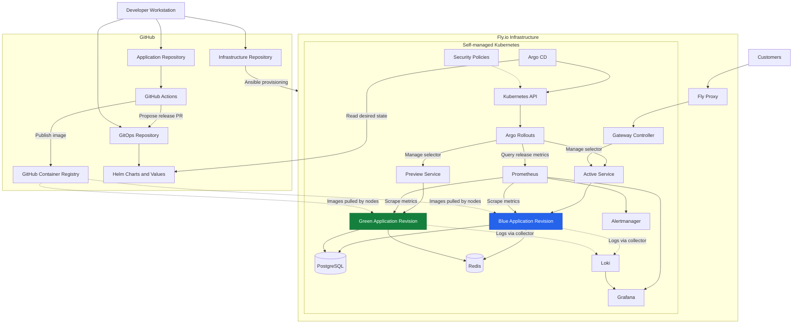
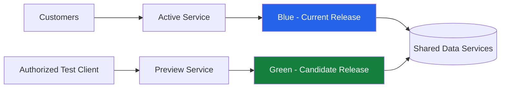

# AgriCommerce | Kubernetes Progressive Delivery Platform

**Production-oriented Kubernetes engineering, GitOps, Blue-Green deployments, DevSecOps and Site Reliability Engineering.**

> An independently engineered, production-style Kubernetes platform designed to demonstrate reliable application delivery, infrastructure automation, operational resilience and secure software delivery.

**Author:** Olusegun Mayungbe

**Project status:** Active development

The architecture and acceptance criteria described in this document represent the target platform. Implementation status and measured results will be updated as individual components are validated.

---

## Table of Contents

- [Project Overview](#project-overview)
- [Business Problem](#business-problem)
- [Engineering Objectives](#engineering-objectives)
- [System Architecture](#system-architecture)
- [Technology Stack](#technology-stack)
- [Repository Architecture](#repository-architecture)
- [CI/CD and GitOps Workflow](#cicd-and-gitops-workflow)
- [Blue-Green Deployment Strategy](#blue-green-deployment-strategy)
- [Security Architecture](#security-architecture)
- [Observability and Reliability](#observability-and-reliability)
- [Infrastructure and Cost Optimization](#infrastructure-and-cost-optimization)
- [Production Acceptance Criteria](#production-acceptance-criteria)
- [Failure and Recovery Scenarios](#failure-and-recovery-scenarios)
- [Implementation Roadmap](#implementation-roadmap)
- [Engineering Evidence](#engineering-evidence)
- [Known Limitations](#known-limitations)

---

## Project Overview

AgriCommerce is a simulated agricultural e-commerce platform
designed to explore the engineering challenges involved in
building, deploying, securing and operating cloud-native
applications.

The application will provide product discovery, inventory
management and order processing capabilities.

The platform focuses on reliable application delivery using
self-managed Kubernetes infrastructure, automated CI/CD,
declarative GitOps and Blue-Green deployment strategies.

This project is designed to demonstrate practical competencies
in DevOps, Platform Engineering, DevSecOps, Kubernetes
Administration and Site Reliability Engineering.

## Business Problem

Modern e-commerce platforms must release software frequently
without compromising customer experience, application
availability or data integrity.

Traditional deployment approaches may introduce downtime,
inconsistent configurations, security vulnerabilities and
difficult recovery procedures.

AgriCommerce addresses these challenges through automated
infrastructure provisioning, immutable application artifacts,
controlled release promotion, continuous monitoring and
repeatable recovery procedures.

## Engineering Objectives

- Build reproducible, self-managed Kubernetes infrastructure.
- Implement highly available control-plane architecture.
- Automate application testing and container image publishing.
- Establish a pull-based GitOps delivery model.
- Package Kubernetes applications using reusable Helm charts.
- Implement controlled Blue-Green deployments.
- Validate application releases before production promotion.
- Automate rollback based on release health.
- Protect application data during deployment and recovery.
- Implement least-privilege access and workload isolation.
- Establish measurable reliability and performance objectives.
- Reduce infrastructure waste through disposable environments.

## System Architecture

The following diagram represents the proposed end-to-end
platform architecture.

The active and preview revisions share compatible persistent
data services. Release colors represent application revisions,
not separate development and production environments.

## Technology Stack

| Technology | Responsibility | Selection Rationale |
|---|---|---|
| Fly.io | Cloud infrastructure | Flexible, disposable infrastructure for hands-on engineering |
| Ansible | Infrastructure automation | Repeatable provisioning and configuration |
| Kubernetes | Container orchestration | Declarative scheduling, scaling and workload management |
| kubeadm | Cluster bootstrapping | Direct exposure to Kubernetes control-plane components |
| containerd | Container runtime | CRI-compatible container execution |
| Calico | Container networking | Kubernetes networking and network policy enforcement |
| React | Frontend | Component-based customer-facing application |
| FastAPI | Backend | Lightweight Python REST API framework |
| PostgreSQL | Database | Transactional consistency and persistent application data |
| Redis | Cache | Reduce repeated database reads |
| Docker | Container image builds | Portable and reproducible application packaging |
| GitHub | Source control | Collaboration, version history and portfolio visibility |
| GitHub Actions | CI automation | Automated build, test and security validation |
| GHCR | Container registry | Versioned container artifact distribution |
| Helm | Application packaging | Reusable Kubernetes templates and environment configuration |
| Argo CD | GitOps | Declarative deployment and drift reconciliation |
| Argo Rollouts | Progressive delivery | Controlled release promotion and health-based rollback |
| Gateway API | Traffic management | Declarative and extensible application routing |
| cert-manager | Certificate management | Automated certificate lifecycle where applicable |
| Prometheus | Metrics | Application and infrastructure monitoring |
| Grafana | Visualization | Operational dashboards and release health analysis |
| Loki | Logging | Centralized application and platform logs |
| Alertmanager | Alert routing | Operational incident notifications |
| Trivy | Security scanning | Container and dependency vulnerability detection |
| Kyverno | Policy enforcement | Declarative Kubernetes admission policies |
| Vault | Secrets management | Centralized secret lifecycle management |
| k6 | Performance testing | Reproducible load and deployment testing |
| Velero | Kubernetes backup | Resource recovery with supported storage integration |

Component versions will be pinned and compatibility-tested
during implementation.

## Repository Architecture

The project adopts a polyrepo architecture to separate
engineering responsibilities and release lifecycles.

| Repository | Responsibility |
|---|---|
| `agricommerce-platform` | Architecture, documentation and engineering evidence |
| `agricommerce-app` | Application source code, tests, images and CI |
| `agricommerce-infrastructure` | Infrastructure integration, networking and storage |
| `agricommerce-gitops` | Helm charts, delivery configuration and platform services |

The existing Fly.io Kubernetes provisioning framework will
serve as the initial infrastructure automation engine.

Repository links will be added after remote repositories
have been created.

## CI/CD and GitOps Workflow

The planned software delivery workflow separates continuous
integration from continuous delivery.

1. Developer creates a feature branch.
2. Application changes are submitted through a pull request.
3. GitHub Actions executes automated tests.
4. Security and dependency scans validate the changes.
5. Container images are built and scanned.
6. Approved images are published to GHCR.
7. A pull request proposes a new image digest in the GitOps repository.
8. The GitOps changes are reviewed and merged.
9. Argo CD reconciles the desired Kubernetes configuration.
10. Argo Rollouts creates and validates the candidate revision.
11. Approved releases receive production traffic.
12. Post-promotion monitoring validates release health.

The CI pipeline will not require direct administrative
access to the Kubernetes cluster.

## Blue-Green Deployment Strategy

Blue-Green deployment maintains two application revisions
during a release.

The active revision serves production traffic while the
candidate revision undergoes controlled validation.

### Release lifecycle

1. Deploy candidate revision.
2. Wait for workload readiness.
3. Validate the candidate using the preview service.
4. Execute functional and performance tests.
5. Require approval before promotion.
6. Switch the active service to the candidate revision.
7. Monitor post-promotion health.
8. Roll back if release analysis fails.
9. Scale down the previous revision after the rollback window.

Database migrations will follow backward-compatible
expand-and-contract principles.

Application rollback does not automatically reverse
database schema or data changes.

## Security Architecture

The planned security model incorporates defense in depth
throughout the software delivery lifecycle.

- Least-privilege Kubernetes RBAC.
- Scoped CI and deployment identities.
- Container and dependency vulnerability scanning.
- Software bill of materials generation.
- Container image signing and verification.
- Non-root application containers.
- Kubernetes network policies.
- Admission control and policy enforcement.
- Centralized secret management.
- Restricted access to preview environments.
- TLS-protected external application traffic.
- Immutable container image digests.

Credentials, tokens, private keys and sensitive
infrastructure configuration must not be committed
to public repositories.

## Observability and Reliability

The platform will expose application and infrastructure
health through metrics, logs and operational dashboards.

The primary reliability indicators will include:

- Request rate.
- Request error rate.
- Request duration.
- CPU and memory utilization.
- Pod availability and restart frequency.
- Database connection health.
- Deployment and rollback duration.

Prometheus metrics will support automated release
analysis through Argo Rollouts.

Grafana dashboards and incident reports will provide
evidence of observed system behavior.

## Infrastructure and Cost Optimization

The platform will run on self-managed Kubernetes clusters
provisioned using Fly.io Machines.

The initial environment will use minimal resources for
development and basic integration testing.

Larger multi-node clusters will be provisioned for
high-availability and failure-recovery exercises.

Cost optimization practices include:

- Disposable Kubernetes environments.
- Infrastructure teardown when testing is complete.
- Right-sized compute and storage resources.
- Resource requests and limits.
- Workload autoscaling where applicable.
- Public GitHub-hosted CI workflows.
- Persistent backup and restoration procedures.

The platform does not require AWS or Azure subscriptions.

## Production Acceptance Criteria

The following are engineering targets, not measured results.

| Metric | Target | Validation |
|---|---|---|
| Deployment downtime | 0 seconds observed | Continuous requests during promotion |
| Application availability | 99.9% SLO | Availability measurement over a defined window |
| API latency | P95 below 300 ms | k6 test under defined normal load |
| Release rollback | Below 60 seconds | Timed recovery with previous revision available |
| Critical image vulnerabilities | Zero unresolved | Container security scan |
| Unapproved production traffic | 0% | Active and preview service validation |
| Infrastructure reproducibility | Repeatable automated deployment | Cluster recreation exercise |
| Data recovery | Successful tested restore | Database and Kubernetes recovery exercise |

Actual measurements, test conditions, RTO and RPO
will be documented after validation.

## Failure and Recovery Scenarios

The platform will be evaluated using controlled failure
injection in isolated learning environments.

| Scenario | Expected Behavior |
|---|---|
| Invalid container image | Block release promotion |
| Failed readiness probe | Keep active revision serving traffic |
| Elevated HTTP error rate | Abort or roll back release |
| Increased request latency | Fail configured release analysis |
| Worker node failure | Reschedule eligible workloads |
| Control-plane node failure | Maintain quorum in HA configuration |
| Database migration failure | Block release |
| Unauthorized network access | Enforce configured network policies |
| GitOps configuration drift | Reconcile desired configuration |
| Critical vulnerability | Block release pipeline |
| Persistent data loss | Recover using tested backups |
| Complete cluster loss | Rebuild infrastructure and restore services |

## Implementation Roadmap

- [x] Define project requirements.
- [x] Select platform technologies.
- [x] Define multi-repository architecture.
- [x] Prepare local development workspace.
- [x] Configure GitHub CLI and authentication.
- [ ] Establish remote repositories.
- [ ] Complete architecture documentation and ADRs.
- [ ] Develop frontend and backend application.
- [ ] Containerize application components.
- [ ] Deploy using native Kubernetes manifests.
- [ ] Implement manual Blue-Green deployments.
- [ ] Develop reusable Helm charts.
- [ ] Implement GitHub Actions pipelines.
- [ ] Configure Argo CD and GitOps.
- [ ] Implement Argo Rollouts.
- [ ] Configure external networking and TLS.
- [ ] Implement observability and alerting.
- [ ] Automate release health analysis and rollback.
- [ ] Implement security policies and secret management.
- [ ] Validate database migration strategies.
- [ ] Perform high-availability and scaling exercises.
- [ ] Test disaster recovery procedures.
- [ ] Execute performance and failure-injection tests.
- [ ] Publish engineering evidence and demonstration.

## Engineering Evidence

The following artifacts will be published as implementation
and validation progress:

| Deliverable | Status |
|---|---|
| Architecture diagrams | Initial design |
| Architectural Decision Records | Planned |
| Infrastructure provisioning runbooks | Planned |
| CI/CD workflow results | Planned |
| GitOps synchronization evidence | Planned |
| Blue-Green deployment demonstration | Planned |
| Performance benchmarks | Planned |
| Security assessment results | Planned |
| Incident reports and postmortems | Planned |
| Backup and restore evidence | Planned |
| Infrastructure cost analysis | Planned |

No performance or reliability results are claimed
before the corresponding tests have been completed.

## Known Limitations

- This is a production-style learning environment,
  not a live commercial production system.
- Fly.io infrastructure is subject to regional capacity
  and resource availability.
- Persistent storage requires explicit backup and
  recovery engineering.
- The existing IPv6 Kubernetes networking configuration
  requires compatibility testing with platform components.
- Multi-region and multi-cluster operation are outside
  the initial implementation scope.
- High availability and recovery capabilities must be
  demonstrated through controlled testing.

These limitations will be reviewed throughout the project.

---

## Author

**Olusegun Mayungbe**

Focus areas: DevOps, Platform Engineering, DevSecOps,
Kubernetes, Cloud Infrastructure and Site Reliability Engineering.

GitHub: [Oluadepe](https://github.com/Oluadepe)

