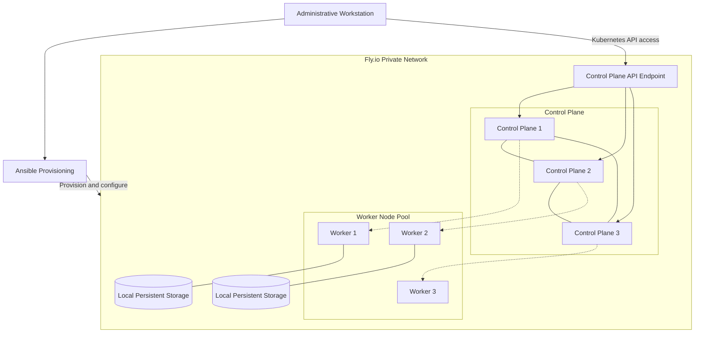

# ADR-001: Self-Managed Kubernetes on Fly.io

## Status

Proposed

## Date

2026-11-25

## Context

AgriCommerce requires a reproducible Kubernetes platform
capable of supporting controlled application delivery,
Blue-Green deployments, high availability, security,
observability and disaster recovery exercises.

The infrastructure must provide sufficient flexibility to
investigate Kubernetes internals while maintaining manageable
operational costs.

The platform must not depend on an AWS or Azure subscription.

An existing Ansible-based Fly.io Kubernetes provisioning
framework provides a foundation for reusable, disposable
cluster infrastructure.

## Decision Drivers

- Infrastructure affordability.
- Reproducible environment provisioning.
- Direct access to Kubernetes control-plane components.
- Ability to investigate container networking.
- Support for controlled infrastructure failure testing.
- Flexible compute and storage configurations.
- Independence from managed Kubernetes services.
- Compatibility with standard cloud-native tooling.
- Automated infrastructure teardown.
- Transferable infrastructure engineering knowledge.

## Alternatives Considered

### Option 1: Local Kubernetes using kind or Minikube

Advantages:

- Minimal cloud infrastructure costs.
- Fast environment creation.
- Suitable for application development.
- Useful for Kubernetes manifest validation.

Disadvantages:

- Limited representation of distributed cloud infrastructure.
- Less realistic node-level failure scenarios.
- Different networking and storage characteristics.
- Limited exposure to independent machine lifecycles.

Local Kubernetes remains suitable for isolated development
and testing exercises.

### Option 2: Managed Kubernetes using AWS EKS or Azure AKS

Advantages:

- Managed control-plane operations.
- Integration with cloud-native load balancers.
- Managed identity and storage integrations.
- Reduced control-plane administration overhead.

Disadvantages:

- Requires additional cloud subscriptions.
- Potentially higher infrastructure expenditure.
- Less direct control-plane operational exposure.
- Provider-specific infrastructure dependencies.

Managed Kubernetes remains a potential future extension,
but is not required for the current project.

### Option 3: Self-Managed Kubernetes on Fly.io Machines

Advantages:

- Independent machine lifecycles.
- Direct access to Kubernetes control-plane components.
- Flexible cluster topology.
- Existing reusable infrastructure automation.
- Support for controlled node failure exercises.
- Ability to provision and destroy temporary environments.
- Compatibility with standard Kubernetes APIs.

Disadvantages:

- Responsibility for control-plane maintenance.
- Additional networking and storage engineering.
- No assumption of native Kubernetes cloud integrations.
- Greater operational complexity.
- Persistent storage requires explicit recovery planning.
- IPv6 compatibility requires validation.

## Decision

Use Fly.io Machines as the infrastructure provider and
self-managed Kubernetes provisioned through the existing
Ansible-based automation framework.

The platform will use:

- kubeadm for Kubernetes cluster bootstrapping.
- containerd as the container runtime.
- Calico for container networking and network policies.
- CoreDNS for Kubernetes service discovery.
- Fly.io private networking for machine communication.
- Fly Volumes where persistent block storage is required.

Cluster topology will be parameterized to support both
cost-efficient development environments and advanced
high-availability testing.

## Target Architecture

The diagram illustrates the target high-availability
topology. Worker nodes communicate with the cluster API
rather than being permanently assigned to individual
control-plane nodes.

## Consequences

### Positive

- Greater exposure to Kubernetes internal architecture.
- Improved understanding of infrastructure dependencies.
- Reproducible development and testing environments.
- Flexible infrastructure resource allocation.
- Ability to investigate failures at multiple system layers.
- Reduced dependency on provider-managed abstractions.

### Negative

- The platform operator is responsible for cluster maintenance.
- External traffic routing requires additional integration.
- Persistent storage requires explicit lifecycle management.
- Cluster security and upgrades require operational planning.
- Production availability cannot be assumed without testing.

## Risk Mitigation

| Risk | Mitigation |
|---|---|
| Unexpected infrastructure expenditure | Disposable clusters and explicit teardown procedures |
| Control-plane failure | Three-member etcd topology for HA testing |
| Persistent data loss | Database-native backups and tested restoration |
| Networking incompatibility | IPv6 compatibility and connectivity testing |
| Credential exposure | Scoped credentials and restricted secret storage |
| Configuration inconsistency | Declarative configuration and version-controlled automation |
| Complete cluster loss | Repeatable provisioning and GitOps restoration |
| Unavailable infrastructure capacity | Parameterized resource and region selection |

## Validation Criteria

The infrastructure decision will be validated through:

- Automated cluster provisioning.
- Kubernetes node readiness verification.
- Pod-to-pod connectivity testing.
- Kubernetes service discovery testing.
- Application workload scheduling.
- Control-plane failure simulation.
- Worker node failure simulation.
- Persistent data restoration.
- Complete cluster recreation.
- Infrastructure cost measurement.

## Implementation Status

The existing provisioning framework has previously
demonstrated successful multi-node Kubernetes provisioning
and basic workload connectivity.

AgriCommerce-specific integrations, application reliability,
storage recovery and failure scenarios remain subject to
validation.

## Related Decisions

Future ADRs will document:

- Repository architecture and governance.
- Container networking and external traffic management.
- Persistent storage architecture.
- Helm application packaging.
- Pull-based GitOps delivery.
- Blue-Green deployment orchestration.
- Observability and release analysis.
- Software supply chain security.

## References

- [Fly.io Machines](https://fly.io/docs/machines/)
- [Kubernetes Documentation](https://kubernetes.io/docs/)
- [kubeadm](https://kubernetes.io/docs/setup/production-environment/tools/kubeadm/)
- [Ansible Documentation](https://docs.ansible.com/)
- [Calico Documentation](https://docs.tigera.io/calico/latest/about/)

