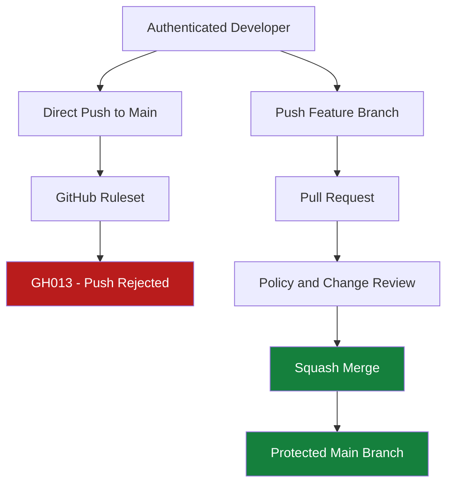

# GOV-001: Protected Branch Enforcement

## Test Summary

| Property | Value |
|---|---|
| Test ID | GOV-001 |
| Category | Repository Governance and DevSecOps |
| Test Date | 2026-11-25 |
| Repository | agricommerce-platform |
| Protected Branch | main |
| Ruleset | protect-main |
| Ruleset ID | 28087318 |
| Test Type | Positive and Negative |
| Test Result | PASS |
| Tested By | Olusegun Mayungbe |

## Objective

Validate that repository governance controls prevent
direct modifications to the protected main branch while
permitting changes through the approved pull request
workflow.

This control establishes the foundation for secure
change management and future GitOps deployment governance.

## Business Risk

Unauthorized changes to deployment configurations can
introduce security vulnerabilities, application failures,
configuration drift and unintended production deployments.

In a GitOps environment, modifications to a monitored
branch may trigger automated reconciliation against
a Kubernetes cluster.

Protecting the source of truth is therefore an essential
part of the platform security architecture.

## Control Configuration

The following GitHub repository ruleset was configured:

| Control | Configuration |
|---|---|
| Enforcement | Active |
| Target | Default branch |
| Restrict branch deletion | Enabled |
| Block non-fast-forward updates | Enabled |
| Require pull requests | Enabled |
| Require conversation resolution | Enabled |
| Bypass actors | None |
| Required independent approvals | 0 |
| Required CI status checks | Not yet configured |

## Test Architecture



## Test Environment

- Fly.io Linux administrative workstation.
- Ubuntu Linux.
- Git version 2.53.0.
- GitHub CLI version 2.105.0.
- HTTPS-based Git authentication.
- Public GitHub repository.
- Active branch ruleset without bypass actors.

## Pre-Test Validation

The effective ruleset configuration was retrieved using
the GitHub REST API through GitHub CLI.

```bash
gh api repos/Oluadepe/agricommerce-platform/rulesets/28087318 \
  --jq '{name, enforcement, bypass_actors}'
```

Actual result:

```json
{
  "bypass_actors": [],
  "enforcement": "active",
  "name": "protect-main"
}
```

The protected main branch initially referenced:

```text
489f6b6b154b9420e0f366fad6b5dbbf83e379c9
```

## Negative Test: Direct Push to Protected Main

### Test Procedure

1. Create a documentation branch from main.
2. Create an architectural decision record.
3. Commit the documentation change.
4. Attempt to push the new commit directly to main.
5. Inspect the server response.
6. Verify that the protected branch remains unchanged.

### Test Command

```bash
git push origin HEAD:main
```

### Expected Result

GitHub must reject the direct push because changes to
main are required to pass through a pull request.

The existing main branch reference must remain unchanged.

### Actual Result

Relevant excerpt from the observed terminal output:

```text
remote: error: GH013: Repository rule violations found
remote:
remote: - Changes must be made through a pull request.
remote:
! [remote rejected] HEAD -> main
error: failed to push some refs
```

GitHub rejected the operation during repository rule
enforcement.

### Integrity Verification

```bash
git ls-remote origin refs/heads/main
```

Actual result:

```text
489f6b6b154b9420e0f366fad6b5dbbf83e379c9 refs/heads/main
```

The remote main branch remained unchanged after the
rejected push.

### Negative Test Result

PASS

The protected branch rejected the prohibited operation
without modifying the existing branch reference.

## Positive Test: Controlled Pull Request

### Test Procedure

1. Refine and finalize the architectural decision record.
2. Publish the documentation branch.
3. Create a pull request targeting main.
4. Inspect the proposed changes.
5. Merge the pull request using squash merge.
6. Synchronize the local main branch.
7. Verify the resulting repository state.

### Actual Result

| Property | Result |
|---|---|
| Pull Request | 1 |
| Source Branch | docs/adr-001-infrastructure-selection |
| Destination Branch | main |
| Merge Strategy | Squash |
| Pull Request State | MERGED |
| Final Commit | df7dd58f40771044ff006cc64d3c41b7c434c0f3 |
| Local Repository | Synchronized |
| Working Tree | Clean |

Pull request evidence:

https://github.com/Oluadepe/agricommerce-platform/pull/1

### Positive Test Result

PASS

The repository permitted a compliant change through
the required pull request workflow.

## Overall Validation Results

| Validation | Expected | Observed | Result |
|---|---|---|---|
| Ruleset enforcement | Active | Active | PASS |
| Bypass actors | None | None | PASS |
| Direct push | Rejected | GH013 rejection | PASS |
| Main reference after rejection | Unchanged | Unchanged | PASS |
| Pull request merge | Permitted | Merged | PASS |
| Repository synchronization | Consistent | Consistent | PASS |
| Working directory | Clean | Clean | PASS |

## Technical Analysis

GitHub successfully authenticated the developer and
received the Git objects associated with the proposed
direct push.

However, repository policy enforcement rejected the
request before updating the protected branch reference.

This demonstrates the distinction between authentication,
authorization and policy-based enforcement.

A valid identity does not automatically authorize every
operation against a protected resource.

The successful pull request subsequently demonstrated
that the intended change-management workflow remained
functional.

## Security Implications

This governance control reduces the risk of:

- Accidental direct changes to the main branch.
- Uncontrolled changes to deployment configurations.
- Bypassing the intended pull request workflow.
- Unreviewed changes entering the future GitOps workflow.

The configured ruleset also includes branch deletion and
non-fast-forward update restrictions.

Those two controls were verified through configuration
inspection but were not independently tested through
destructive operations.

## Limitations

This is a single-contributor engineering project.

Independent human approval is not currently required.

Automated CI status checks have not yet been configured.

The validated control therefore enforces the pull request
workflow but does not yet establish independent review
or automated quality assurance.

Repository administrators may also have permission to
modify repository governance settings.

This exercise does not demonstrate protection against
all possible privileged administrative actions.

## Future Improvements

- Require automated CI status checks.
- Implement workflow validation.
- Introduce commit signing.
- Implement secret detection.
- Configure CODEOWNERS.
- Automate repository ruleset provisioning.
- Introduce independent review when collaborators are available.
- Apply equivalent governance controls to the GitOps repository.

## Conclusion

The protected branch enforcement test passed.

Both the rejected direct push and successful controlled
pull request demonstrate that the configured change
management workflow behaves as intended under the
tested conditions.

This control provides a validated foundation for
subsequent GitOps and software supply chain security
implementation.

## References

- [GitHub Repository Rulesets](https://docs.github.com/en/repositories/configuring-branches-and-merges-in-your-repository/managing-rulesets)
- [GitHub CLI](https://cli.github.com/manual/)
- [AgriCommerce Pull Request 1](https://github.com/Oluadepe/agricommerce-platform/pull/1)
