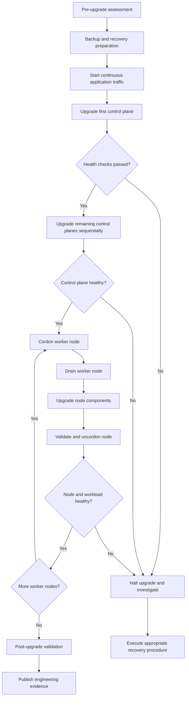

# OPS-001: Zero-Downtime Kubernetes Cluster Upgrade

## Status

Planned

## Category

Kubernetes Administration, Platform Engineering and SRE

## Interview Question

How would you upgrade a production Kubernetes cluster
without interrupting customer-facing applications or
compromising data integrity?

## Business Context

AgriCommerce requires periodic Kubernetes upgrades to
maintain platform security, compatibility and supportability.

The upgrade must preserve application availability and
customer transactions while minimizing operational risk.

## Objectives

- Perform a supported Kubernetes version upgrade.
- Maintain application availability throughout the upgrade.
- Preserve etcd quorum and application data integrity.
- Upgrade control-plane and worker nodes sequentially.
- Validate workload disruption budgets.
- Establish repeatable upgrade and recovery procedures.
- Automate the validated procedure using Ansible.

## Prerequisites

- Three healthy control-plane nodes.
- Three worker nodes with sufficient spare capacity.
- Healthy etcd cluster and tested snapshots.
- Redundant application gateway.
- Distributed application replicas.
- Appropriate PodDisruptionBudgets.
- Readiness probes and graceful termination.
- Tested database backups and failover.
- Continuous application traffic generation.
- Prometheus and Grafana monitoring.
- Verified source and target Kubernetes compatibility.

## Upgrade Workflow

## Execution Plan

1. Inventory Kubernetes component versions.
2. Review release notes and deprecated APIs.
3. Validate version-skew requirements.
4. Validate CNI, storage and controller compatibility.
5. Confirm workload capacity and disruption budgets.
6. Create and validate recovery backups.
7. Establish baseline availability and performance.
8. Start continuous application traffic.
9. Upgrade the first control-plane node.
10. Validate API availability and etcd quorum.
11. Upgrade remaining control-plane nodes individually.
12. Cordon and drain each worker node sequentially.
13. Upgrade the appropriate Kubernetes components.
14. Validate node health before uncordoning.
15. Verify application health before continuing.
16. Validate the complete upgraded cluster.
17. Compare pre-upgrade and post-upgrade performance.
18. Automate the validated procedure using Ansible.

## Failure Simulations

| Scenario | Expected Response |
|---|---|
| Control-plane upgrade failure | Halt upgrades and preserve quorum |
| Blocked node drain | Investigate eviction restrictions and workload health |
| Insufficient worker capacity | Restore or increase available capacity |
| Failed kubelet restart | Diagnose and recover the affected node |
| CNI incompatibility | Halt further upgrades and investigate |
| API deprecation | Correct incompatible resources |
| Database failover failure | Halt maintenance and initiate recovery |
| Increased application errors | Stop further node changes |
| Complete upgrade failure | Execute the tested recovery procedure |

## Acceptance Criteria

| Metric | Target |
|---|---|
| Observed application downtime | Zero seconds |
| Failed test requests | Zero |
| Lost committed transactions | Zero |
| etcd quorum | Maintained |
| Critical workload availability | At least two replicas |
| Kubernetes versions | All nodes upgraded |
| Networking and DNS | Operational |
| Recovery validation | Successful |
| Performance | Within the defined SLO |

## Recovery Strategy

A failed upgrade must trigger an immediate pause before
additional nodes are modified.

Recovery will depend on the affected component and the
failure conditions. Kubernetes downgrades must not be
assumed to be supported.

The recovery strategy may include repairing the affected
node, replacing a failed worker, recovering control-plane
components or restoring the cluster from validated backups.

Recovery procedures will be tested in disposable
infrastructure before being considered reliable.

## Engineering Evidence

The following artifacts will be collected during execution:

- Pre-upgrade cluster health report.
- Before-and-after Kubernetes versions.
- etcd health and backup validation.
- Node cordon and drain results.
- PodDisruptionBudget enforcement evidence.
- Continuous k6 traffic results.
- Grafana availability and latency dashboards.
- Application transaction validation.
- Upgrade duration.
- Recovery exercise results.
- Ansible upgrade automation.
- Operational lessons and improvement recommendations.

## Results

Pending implementation and validation.

No zero-downtime or reliability claims are made until
the corresponding measurements have been collected.

## References

- [Upgrading kubeadm clusters](https://kubernetes.io/docs/tasks/administer-cluster/kubeadm/kubeadm-upgrade/)
- [Kubernetes version skew policy](https://kubernetes.io/releases/version-skew-policy/)
- [Pod disruptions](https://kubernetes.io/docs/concepts/workloads/pods/disruptions/)
- [Safely drain a node](https://kubernetes.io/docs/tasks/administer-cluster/safely-drain-node/)

